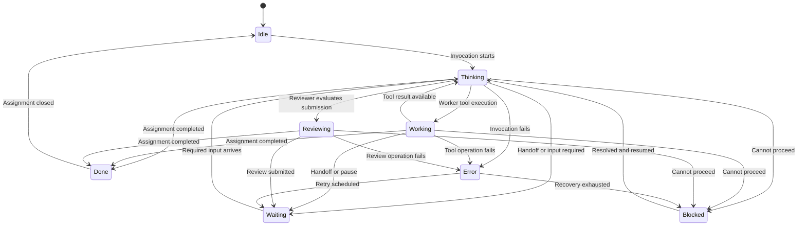
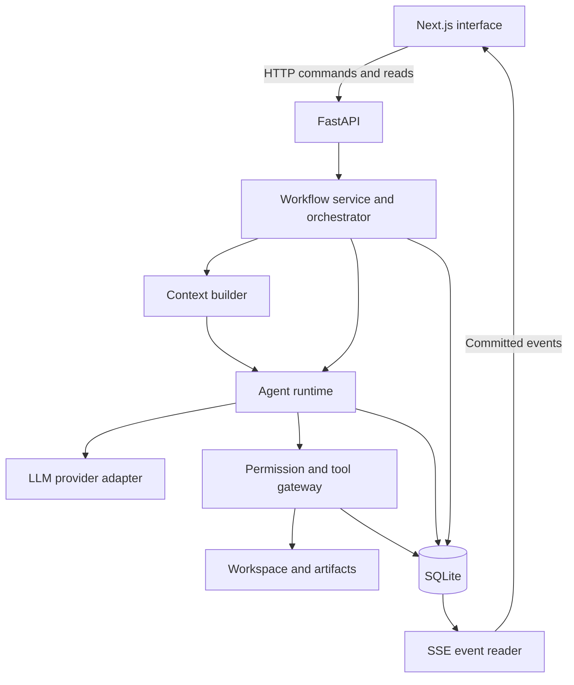

# AI Office — V1 blueprint

AI Office should be a small, observable workspace where you give a goal to three AI employees, watch work move between them, and intervene when needed.

I recommend a visually expressive office backed by a deliberately simple execution system: one active project run, one task being executed at a time, three configurable agents, and a Python orchestrator that enforces the rules.

The central architectural distinction is this: **the Manager proposes decisions; the application validates and executes them.** Permissions, retry limits, task dependencies, and completion rules must remain enforced by code.

This is a design proposal only. No application code has been implemented.

## 1. Product concept

**Product promise:** “Give your AI office a goal, see who is doing what, and stay in control of the result.”

The experience has three complementary views:

| View | What it helps you understand |
|---|---|
| Office | Who is working, waiting, reviewing, or blocked |
| Task board | What needs doing and how far it has progressed |
| Activity and evidence | What actually happened, what changed, and why |

The office should be the main navigation surface. Clicking an employee, task, handoff, or warning opens the corresponding evidence.

For V1, the employees are three persistent identities with different configurations. They do not need separate operating-system processes or continuously running LLM conversations.

Recommended operating boundaries:

- Single local user.
- Multiple saved projects, but only one active run across the application.
- Exactly one Manager, one Worker, and one Reviewer per project.
- Worker specialization: Software Developer.
- One implementation/review cycle at a time.
- A dedicated project workspace on disk.
- One initial LLM provider integration behind an adapter.

“Local” describes where the application and files run. A hosted LLM provider still receives the context submitted to it.

## 2. Main use cases

| Use case | Expected experience |
|---|---|
| Build a small project | Enter a goal, review the plan, start execution, inspect the result |
| Make a bounded change | Identify an existing workspace and describe the requested change |
| Follow progress | Watch real task handoffs, file changes, reviews, and usage |
| Correct direction | Pause, clarify a requirement, and resume with an updated plan |
| Resolve a blocker | Answer a question, grant a scoped permission, or change the task |
| Inspect a failure | Open the review, see evidence, and compare revision attempts |
| Resume interrupted work | Reopen a project, inspect the last checkpoint, explicitly resume |
| Configure employees | Change names, instructions, models, and permitted tools |

A suitable first end-to-end demonstration is a small utility with tests: the Manager defines acceptance criteria, the Worker implements it, the Reviewer finds a defect, and a revision passes.

## 3. Detailed user flow

1. **Create a project.** Enter the goal, constraints, and workspace. Show a brief summary of which file and command permissions are enabled.

2. **Configure the office.** Use default employee definitions or adjust models, instructions, and review limits. API credentials remain backend-only.

3. **Ask the Manager to plan.** The Manager produces requirements, assumptions, tasks, dependencies, and acceptance criteria. If a missing answer would materially change the work, execution waits for the user.

4. **Review the plan.** Present an editable task list with a primary “Start work” action. Planning approval is the recommended default; the user need not approve routine handoffs afterward.

5. **Execute a task.** The Manager chooses a ready task. The orchestrator validates the assignment and starts the Worker.

6. **Observe implementation.** Show actual file operations, tool activity, test outcomes, and a concise progress summary.

7. **Review an output version.** The Worker submits a versioned work package. The Reviewer checks that package against its acceptance criteria.

8. **Handle the outcome.**
   - PASS → Manager accepts the task or identifies a specific remaining requirement.
   - FAIL → Manager issues a revision brief, within the configured limit.
   - Unable to evaluate → task becomes blocked or the review operation errors; this is not automatically a quality failure.

9. **Complete the project.** After all required tasks pass, the Manager produces a final summary linking changes, evidence, limitations, and usage.

10. **Inspect or reopen.** The user can browse artifacts and reviews or begin a new run with additional requirements.

Human controls should be available throughout:

| Control | Exact behavior |
|---|---|
| Pause | Stop scheduling new calls/tools; reach the next safe boundary |
| Stop now | Attempt to cancel the current request/process; retain completed changes |
| Send instruction | Record the instruction and apply it at a safe boundary |
| Edit scope | Pause, version requirements, reassess affected tasks |
| Resume | Continue from the last valid checkpoint |
| Cancel run | End this run without deleting its history or files |

A pause request must show “Pausing…” until acknowledged. Cancellation cannot promise to undo file changes or prevent billing for an already submitted request.

## 4. Screen/page structure

Keep navigation small.

| Screen | Main contents |
|---|---|
| Projects | Saved projects, status, last activity, create/open |
| New project | Goal, requirements, workspace, employee defaults |
| Project workspace | Office, task board, activity feed, usage strip |
| Project settings | Requirements, agent definitions, permissions, execution limits |
| Application settings | Provider credentials, model settings, price configuration |

Within the project workspace, use panels rather than separate pages for:

- Agent details.
- Task details and review history.
- File changes and artifacts.
- Permission requests.
- Final results.
- Expanded usage breakdown.

Keep the project goal, current execution state, and Pause/Resume controls visible while panels are open.

## 5. Office UI layout

Recommended style: a compact, softly illustrated 2D office built with HTML, CSS, and SVG. Use readable employee labels and task information alongside visual character.

A desktop wireframe:

```text
┌─────────────────────────────────────────────────────────────────────┐
│ AI OFFICE / Project name           Running    Pause    Stop          │
│ Goal: Build a small utility…                                         │
├───────────────────────────────────────────┬─────────────────────────┤
│                                           │ CONTEXT PANEL           │
│            🧑‍💼 MANAGER                    │                         │
│            Thinking                       │ Selected employee,      │
│            Prioritizing Task #3           │ task, review, or file   │
│                  desk                     │                         │
│                 /    \                    │ Current task            │
│                /      \                   │ Recent activity         │
│    👨‍💻 WORKER           🧐 REVIEWER         │ Messages                │
│    Working             Waiting            │ Tools                   │
│    Task #2             For submission     │ Tokens / estimated cost │
│      desk                 desk            │                         │
├───────────────────────────────────────────┴─────────────────────────┤
│ BACKLOG │ TODO │ IN PROGRESS │ REVIEW │ DONE │ BLOCKED               │
│ Task cards: ID, title, assignee, dependencies, reviews               │
├───────────────────────────────────────────┬─────────────────────────┤
│ ACTIVITY FEED                             │ RESOURCE MONITOR        │
│ Timestamp · actor · action · evidence     │ Tokens · cost · calls   │
└───────────────────────────────────────────┴─────────────────────────┘
```

Office behaviors should follow specific backend events:

| Event | Visual response |
|---|---|
| Manager invocation starts | Manager displays Thinking |
| Assignment commits | Task envelope travels Manager → Worker |
| Worker tool starts | Worker displays Working and tool label |
| Submission commits | Package travels Worker → Reviewer |
| Review starts | Reviewer displays Reviewing |
| FAIL commits | Feedback travels Reviewer → Manager |
| Revision assignment commits | Revision brief travels Manager → Worker |
| PASS accepted | Task gets a completion mark |

Animations are brief acknowledgments, never a requirement for execution to continue.

Additional UX rules:

- Status labels always accompany colors.
- “Waiting” identifies what the employee is waiting for.
- Clicking a handoff opens its structured message.
- Reduced-motion mode replaces movement with highlights.
- Keyboard users can focus employees and open their panels.
- On smaller screens, stack employee workspaces and use tabs for board/activity.
- On reconnection, restore current state without replaying old handoff animations.
- A disconnected browser displays “Connection lost”; it must not assume the agents stopped.

## 6. Agent interaction model

All communication passes through structured records managed by the orchestrator.

| Agent | Input | Output | Authority |
|---|---|---|---|
| Manager | Goal, requirements, task summaries, relevant feedback | Plan, assignments, revision decisions, final summary | Propose workflow decisions |
| Worker | Task brief, relevant files, dependencies, prior feedback | File changes, test results, submission | Use explicitly permitted implementation tools |
| Reviewer | Acceptance criteria, submitted output version, evidence | PASS/FAIL and structured findings | Review and report; cannot edit the output |

The Manager gets workflow operations such as `propose_plan`, `assign_task`, `request_revision`, and `request_user_input`. It does not get implementation tools.

The Reviewer gets read access to the submitted material. Its write authority is limited to its own review record.

The application checks every proposed decision:

- Are dependencies satisfied?
- Is this a permitted state transition?
- Is the feedback tied to the current output version?
- Are review and execution limits still available?
- Does the run permit further work?

No agent can grant itself tools, raise its limits, bypass review, or declare completion outside those checks.

**Recommendation:** direct Python orchestration with typed inputs and outputs.

**Alternative:** a general multi-agent framework.

**Trade-off:** direct orchestration requires a little explicit workflow code, but makes this fixed three-role process easier to inspect and debug. A framework becomes more useful if future workflows become substantially more varied.

## 7. Task lifecycle/state machine

```mermaid
stateDiagram-v2
    [*] --> BACKLOG
    BACKLOG --> TODO: Approved and dependencies satisfied
    TODO --> IN_PROGRESS: Worker starts
    IN_PROGRESS --> REVIEW: Versioned submission accepted
    REVIEW --> DONE: PASS and Manager acceptance
    REVIEW --> TODO: Revision requested within limit

    BACKLOG --> BLOCKED: Missing prerequisite
    TODO --> BLOCKED: Cannot start
    IN_PROGRESS --> BLOCKED: Permission, failure, or limit
    REVIEW --> BLOCKED: Cannot evaluate or limit exhausted

    BLOCKED --> TODO: Resolved, implementation needed
    BLOCKED --> REVIEW: Resolved, same submission reviewable

    DONE --> TODO: Explicit reopen; prior acceptance invalidated
```



State meanings:

| State | Meaning |
|---|---|
| BACKLOG | Proposed or waiting for dependencies |
| TODO | Approved and ready for implementation |
| IN PROGRESS | Worker owns the active implementation attempt |
| REVIEW | A submitted output is awaiting or undergoing review |
| DONE | Current output passed and Manager accepted it |
| BLOCKED | Progress needs an explicit resolution |

Ordinary dependency waiting can remain in BACKLOG. Reserve BLOCKED for a problem requiring attention.

Task records also need `blocked_reason` and `resume_phase`, so resuming does not blindly rerun implementation.

Recommended review limit:

- `max_review_rounds = 3`.
- This permits an initial review plus two revision reviews.
- A round begins when a distinct submission is admitted for review.
- Technical retries within that round use separate limits.
- Exhaustion moves the task to BLOCKED and requires a user decision.

Limits survive pauses and application restarts. Reopening a task or creating a replacement task must not silently erase its attempt history.

Dependencies form a directed acyclic graph. Reject self-dependencies and cycles. Reopening a completed prerequisite requires reassessing dependent tasks before continuing.

Use a separate canceled disposition for removed tasks; canceled work never counts as completed work.

## 8. Agent lifecycle/state machine

Employee status describes the current activity. It is separate from task state.



Examples:

- Manager while the Worker executes: Waiting.
- Worker awaiting command permission: Blocked.
- Reviewer awaiting submission: Waiting.
- Worker calling the model after a tool result: Thinking.
- Reviewer producing a review: Reviewing.

“Thinking” means an LLM request is underway. It does not imply access to the model’s private reasoning. Show concise progress descriptions, decisions, and evidence.

Also define a run lifecycle:

`DRAFT → PLANNING → AWAITING_APPROVAL → RUNNING → COMPLETED`

With controlled branches to `PAUSE_REQUESTED`, `PAUSED`, `WAITING_FOR_USER`, `FAILED`, and `CANCELED`.

## 9. Shared project state design

The shared state is structured information in SQLite plus files and artifacts on disk. It is not one growing transcript.

| State group | Contents |
|---|---|
| Project | Goal, workspace, constraints, requirement version |
| Requirements | Stable IDs, descriptions, acceptance criteria, importance |
| Execution | Run ID, status, phase, current task, limits, checkpoint |
| Tasks | Briefs, priorities, dependencies, state, attempt references |
| Decisions | Decision, reason, author, affected requirements/tasks |
| Outputs | Worker submissions, summaries, artifact references |
| Reviews | Verdicts, findings, evidence, submission references |
| Agents | Definitions, configuration versions, runtime status |
| Activity | Structured messages and committed events |
| Resources | LLM calls, tokens, price snapshots, cost estimates |

Each agent receives a purpose-built context package:

| Agent | Default context |
|---|---|
| Manager | Goal, requirements, task summaries, blockers, latest relevant review |
| Worker | Current task, relevant requirements, dependency outputs, selected files, latest findings |
| Reviewer | Acceptance criteria, relevant requirements, submitted files/diff, test evidence |

Context policy should define:

- Input-token budget and reserved output capacity.
- Allowed information sources.
- File-size and tool-output limits.
- How relevant decisions are selected.
- What to summarize or omit.
- What requires fetching additional context.

Record a context manifest for each invocation: requirement version, task revision, file hashes, selected artifacts, and configuration version.

If required evidence does not fit, split the task or fetch more context in bounded steps. Do not silently truncate essential requirements.

## 10. Event/message structure between agents

Distinguish three concepts:

- **Command:** a requested action, such as pausing a run.
- **Message:** a structured handoff, such as a revision brief.
- **Event:** a committed fact, such as a task assignment being accepted.

A conceptual event envelope:

```json
{
  "schema_version": 1,
  "event_id": "evt_...",
  "sequence": 184,
  "project_id": "project_...",
  "run_id": "run_...",
  "task_id": "task_3",
  "type": "review.completed",
  "occurred_at": "2026-09-21T05:35:00Z",
  "actor": {
    "kind": "agent",
    "id": "reviewer"
  },
  "correlation_id": "attempt_3",
  "causation_id": "evt_...",
  "payload": {
    "review_id": "review_...",
    "submission_id": "submission_...",
    "verdict": "FAIL",
    "finding_count": 2
  }
}
```

This is a data contract example, not implementation code.

Important event families:

| Family | Examples |
|---|---|
| Run | Started, pause requested, paused, resumed, completed |
| Task | Created, assigned, started, blocked, completed |
| Agent | Status changed, invocation started/finished |
| Tools | Requested, permission required, started, finished, failed |
| Output | File changed, artifact created, submission created |
| Review | Started, completed, revision requested |
| Usage | Call usage recorded or reconciled |
| Human | Instruction added, permission granted/denied, scope changed |

A revision message should contain the task, submission and review IDs, required fixes, acceptance criteria, and remaining review rounds.

A review should contain:

- PASS or FAIL.
- Criterion-by-criterion assessment.
- Findings with severity and requirement references.
- File/evidence references.
- Requested fixes.
- Checks not performed.

Large logs and file content belong in artifacts, referenced by ID. Display text in the activity feed should be rendered from structured events.

## 11. Suggested database schema

Use relational tables for relationships and lifecycle state; JSON columns are reasonable for bounded structured documents such as acceptance criteria and tool arguments.

| Table | Important fields |
|---|---|
| `projects` | ID, name, goal, workspace root, requirement version, requirements JSON, settings |
| `agents` | ID, project ID, agent kind, name, role, responsibilities, instructions, provider/model, tools, permissions, context policy, config version |
| `runs` | ID, project ID, state, phase, current task, config snapshot, limits, checkpoint, execution generation, timestamps |
| `tasks` | ID, project ID, task number, title, brief, criteria JSON, priority, assignee, state, revision, blocked reason, disposition |
| `task_dependencies` | Task ID, prerequisite task ID |
| `task_attempts` | ID, task ID, run ID, attempt number, status, submission manifest, summary, timestamps |
| `reviews` | ID, attempt ID, round number, verdict, criteria assessments, findings, review status |
| `decisions` | ID, project/run/task references, author, decision, reason, requirement version |
| `artifacts` | ID, attempt ID, kind, relative path, content hash, size, metadata |
| `agent_invocations` | ID, run/task/agent references, config/context manifest, status, input/output references, error |
| `llm_calls` | ID, invocation ID, provider/model, request ID, status, token breakdown, usage source, rates, estimated cost |
| `tool_calls` | ID, invocation ID, tool, arguments, permission decision, status, result reference, timestamps |
| `interventions` | ID, run ID, action, payload, idempotency key, expected version, pending/applied/rejected status |
| `events` | Sequence, event ID, project/run/task references, type, actor, schema version, payload, timestamp |

Agent messages can be typed event payloads in V1; a separate inbox table is unnecessary.

Important constraints:

- Unique `(project_id, agent_kind)`; validate that each project has exactly the three required kinds.
- Unique task number within a project.
- Unique attempt and review round numbers within their parent.
- Foreign keys enabled.
- Application validation for dependency cycles and state transitions.
- Version checks on state-changing commands.
- One active run enforced transactionally.

Use SQLite WAL mode, short transactions, and a busy timeout. SQLite supports concurrent readers in WAL mode but still permits only one writer at a time, which fits this execution model. [SQLite isolation documentation](https://sqlite.org/isolation.html)

Keep current state authoritative in tables and maintain an append-only event history alongside it. Rebuilding the entire application solely from events would add unnecessary V1 complexity.

## 12. Backend architecture



Logical responsibilities:

| Module | Responsibility |
|---|---|
| API | Validate requests and expose snapshots, commands, artifacts, events |
| Workflow service | Apply legal state changes transactionally |
| Orchestrator | Select the next phase and invoke the appropriate agent |
| Agent runtime | Run bounded model/tool loops |
| Context builder | Assemble the minimum useful context |
| Tool gateway | Authorize, execute, and record tool operations |
| Provider adapter | Normalize provider requests, responses, and usage |
| Persistence | Store state, calls, checkpoints, and events |

Run one FastAPI process with one supervised execution loop managed by application lifespan. Long-running work belongs to that loop, not to the lifetime of a browser request.

Use asynchronous provider calls and subprocess handling so the API remains responsive during work. Do not hold database transactions open while waiting for an LLM or command.

On restart, mark unfinished operations as interrupted and require explicit resume after reconciliation. Do not assume that an interrupted tool never ran.

**Alternative:** a separate job worker and queue.

**Trade-off:** separating execution can help later with concurrent runs and independent restarts; one process is easier to operate locally.

## 13. Frontend architecture

Use Next.js App Router and TypeScript.

Recommended component boundaries:

- `OfficeScene`
- `AgentDesk`
- `AgentDetailPanel`
- `TaskBoard`
- `TaskDetailPanel`
- `ActivityFeed`
- `ResourceMonitor`
- `RunControls`
- `ArtifactViewer`

Keep interactive office state in Client Components. Next.js distinguishes server-rendered components from Client Components that need state, event handlers, and browser APIs. [Next.js component documentation](https://nextjs.org/docs/app/getting-started/server-and-client-components)

Use a small React reducer/context store for the active project:

- Canonical snapshot from FastAPI.
- Connection state.
- Selected agent/task.
- Pending user commands.
- Recent animation acknowledgments.

On committed events, refresh or merge affected server state. Never advance tasks based on timers or animation completion.

The frontend may optimistically show “Pause requested,” but only a backend acknowledgment changes the run to Paused.

Use CSS/SVG for desks and handoff paths.

**Alternative:** Canvas or a game engine.

**Trade-off:** Canvas offers richer scenes but makes accessibility, text rendering, responsive layouts, and interaction more involved. The office does not need game-engine machinery.

## 14. Real-time event architecture

Recommend **SSE for server-to-browser updates and HTTP requests for user commands**.

SSE supports event IDs and reconnect behavior; the browser can send `Last-Event-ID` when reconnecting. The application must implement retained-event replay. [HTML SSE standard](https://html.spec.whatwg.org/multipage/server-sent-events.html)

FastAPI also documents SSE streaming and event-ID support. [FastAPI SSE documentation](https://fastapi.tiangolo.com/tutorial/server-sent-events/)

Reliable startup and recovery:

1. Read a project snapshot and its event cursor in one consistent database snapshot.
2. Connect to the stream requesting events after that cursor.
3. Read durable events in sequence order.
4. Reconnect from the last processed cursor.
5. Ignore already processed events.
6. Refetch the snapshot if the cursor is no longer available.

State updates and their events commit in the same transaction. This prevents an animation for a task assignment that never actually committed.

For V1, the stream can check the indexed event table every 250–500 milliseconds and send keepalive comments during inactivity. That avoids needing a message broker or a complex subscription system.

Keep one stream per open project view. Slow or disconnected consumers must not block execution.

**Alternative:** WebSocket.

**Trade-off:** WebSocket is useful for continuous two-way interaction. Here, human commands are occasional and server updates dominate, making SSE a simpler fit.

## 15. LLM/tool-call architecture

Use one agent runtime parameterized by the employee definition.

An agent definition includes:

| Field | Purpose |
|---|---|
| `id`, `name` | Stable identity and display name |
| `agent_kind` | Manager, Worker, or Reviewer workflow position |
| `role` | Specialization such as Software Developer |
| `responsibilities` | Intended responsibilities |
| `system_instructions` | Behavioral instructions |
| `provider`, `model` | LLM configuration |
| `tools` | Available tool identifiers |
| `permissions` | Enforced capability constraints |
| `context_policy` | Context selection and size limits |
| `status` | Runtime projection, not an editable instruction |

Separate `agent_kind` from `role` so the Worker specialization can change later without changing workflow ownership.

Each invocation follows:

1. Build context and capture its versions.
2. Check run state and execution limits.
3. Send the provider request.
4. Record usage and normalize the response.
5. Validate structured output or tool arguments.
6. Authorize and execute approved tools.
7. Return bounded tool results to the same invocation.
8. Finish with a validated result or a bounded failure.

Provider adapters should normalize:

- Text and structured output.
- Tool requests and results.
- Usage categories.
- Finish reasons.
- Rate-limit and transport errors.
- Capability differences.

Declare provider capabilities explicitly. If a model cannot support the required tool or structured-output behavior, reject that configuration or offer a clearly defined supported mode.

Freeze agent configuration for each invocation. Configuration edits apply to future invocations.

The Reviewer receives a submitted file version, not a moving workspace. V1 can store changed-file copies, hashes, diffs, and relevant supporting files for each submission.

## 16. Permission model

Permissions must be enforced by the tool gateway, independently of prompts.

| Capability | Manager | Worker | Reviewer |
|---|---|---|---|
| Read project/task state | Allowed | Relevant subset | Relevant subset |
| Propose workflow changes | Allowed | No | No |
| Read project files | Selected summaries/artifacts | Allowed in scope | Submitted snapshot |
| Create/edit project files | No | Allowed in scope | No |
| Run development commands | No | Explicitly permitted commands | No by default |
| Write review results | No | No | Allowed |
| Deploy or send email | No | No | No |
| Change permissions | No | No | No |

File enforcement:

- Resolve paths against the configured workspace.
- Reject traversal and symlink escapes.
- Protect secrets, application configuration, and the AI Office database.
- Restrict deletion separately from ordinary editing.
- Check expected file hashes before overwriting externally changed files.

Command enforcement:

- No unrestricted shell tool by default.
- Use structured executable/argument requests.
- Restrict working directory, environment, timeout, output size, and concurrency.
- Bind approvals to the exact requested action or a deliberately scoped rule.
- Recheck run state immediately before executing.

A command allowlist is not an operating-system sandbox: even an approved test command can execute project code. For V1, treat command execution as trusted local code execution with explicit user authorization. If strict prevention of network access or writes outside the workspace is required, command execution needs OS-level isolation or must remain disabled.

Reviewer test reruns can be added later in a disposable isolated workspace. The default Reviewer reads submitted code and recorded test evidence.

## 17. Error/retry handling

Keep quality revisions separate from infrastructure retries.

| Failure | Recommended handling |
|---|---|
| Provider timeout or rate limit | Bounded exponential backoff with jitter |
| Invalid structured output | One corrective retry, then block/error |
| Test failure | Record evidence; Worker may fix within its invocation limits |
| Reviewer FAIL | Manager issues a bounded revision |
| Missing permission | Block and request the specific permission |
| Missing information | Wait for a user answer |
| Tool outcome uncertain | Inspect state before any retry |
| Backend restart | Mark interrupted, reconcile, offer resume |
| Browser disconnect | Continue execution; restore UI through snapshot/replay |
| External file change | Block conflicting edits and reassess the submission |

Suggested starting defaults, all configurable:

| Limit | Starting value |
|---|---|
| Review rounds per task | 3 |
| Automatic provider retries | 2 |
| Structured-output repair attempts | 1 |
| Tool executions per invocation | 20 |
| LLM requests per invocation, including retries | 25 |
| Total LLM requests per run | 100 |
| Command timeout | 120 seconds |
| Invocation wall-time limit | 10 minutes |

Also cap tasks created per run and replanning attempts. Otherwise the Manager could evade a task-level review limit by repeatedly creating replacement tasks.

For interruption safety:

- Check a cancellation/pause flag before every new side effect.
- Increment an execution generation when scope changes or work is canceled.
- Reject stale results from an older generation.
- Still record usage from stale or canceled requests.
- Record tool intent before execution and outcome afterward.
- Never automatically repeat a potentially successful side effect merely because its acknowledgment was lost.

Files and SQLite cannot share a single atomic transaction. Preserve write metadata and checkpoints so interrupted operations can be reconciled instead of pretending rollback is guaranteed.

## 18. Token and cost tracking design

Record usage for every provider request, including planning, reviews, revisions, and retries.

Each call should capture:

- Provider and actual model returned.
- Employee, run, task, and invocation.
- Input and output tokens.
- Cached input and other provider billing categories where available.
- Provider-reported versus locally estimated usage.
- Applied prices, currency, and price effective date.
- Estimated cost and completeness status.
- Provider request ID and timestamps.

For a basic provider:

```text
estimated cost =
    uncached input tokens × uncached input rate
  + cached input tokens   × cached input rate
  + output tokens         × output rate
```

Apply the rate’s unit consistently, such as price per million tokens. Provider adapters must handle categories that overlap; for example, do not add cached tokens twice if they are already included in total input.

Store prices and costs with decimal arithmetic or integer monetary units, not binary floating point.

The dashboard should show:

- Total, input, and output tokens.
- Estimated API cost.
- Cost and calls per employee.
- Total provider requests.
- Current and completed task counts.
- Review rounds and revision count.
- Technical retries separately.
- Unknown or incomplete usage.

Unknown pricing is “Cost unavailable,” never `$0`. An interrupted request may remain billable even when final usage is unavailable.

Aggregate from stored call records, not by incrementing totals whenever an SSE event arrives.

For future budgets, place a policy check immediately before provider requests and preserve per-call pricing and output limits now. Do not implement budget allocation or model-routing optimization in V1.

A future hard budget would need conservative reservations for in-flight calls; completed-call totals alone cannot guarantee a ceiling.

## 19. Suggested project folder structure

This is a proposed structure, not a scaffold created during this design phase.

```text
ai-office/
├── apps/
│   ├── web/
│   │   └── src/
│   │       ├── app/
│   │       ├── features/
│   │       │   ├── office/
│   │       │   ├── tasks/
│   │       │   ├── activity/
│   │       │   ├── usage/
│   │       │   └── settings/
│   │       ├── components/
│   │       └── lib/
│   │           ├── api/
│   │           ├── events/
│   │           └── state/
│   └── api/
│       ├── app/
│       │   ├── main.py
│       │   ├── api/
│       │   ├── domain/
│       │   ├── orchestration/
│       │   ├── agents/
│       │   ├── context/
│       │   ├── providers/
│       │   ├── tools/
│       │   ├── permissions/
│       │   ├── persistence/
│       │   └── usage/
│       ├── migrations/
│       └── tests/
├── config/
│   ├── agents/
│   └── model-pricing/
├── docs/
│   ├── blueprint.md
│   ├── contracts.md
│   └── decisions.md
└── data/                      # Local runtime data; excluded from Git
    ├── office.sqlite
    ├── workspaces/
    └── artifacts/
```

Use typed backend schemas as the API contract and generate TypeScript types where practical. Avoid maintaining unrelated copies of every contract manually.

## 20. MVP scope

V1 should include:

- Exactly three configurable employee definitions.
- Developer specialization for the Worker.
- Goal and requirements entry.
- Manager planning and user plan approval.
- Dependency-aware, sequential task execution.
- Scoped file tools and explicitly authorized command execution.
- Immutable submission evidence.
- Structured PASS/FAIL reviews.
- Bounded revisions and technical retries.
- Pause, stop, resume, instruction, and permission controls.
- Live office, task board, activity feed, and employee panels.
- Per-call token and estimated-cost recording.
- SQLite persistence and restart recovery.
- One functional provider adapter.
- Localhost operation with narrowly configured origins and protected mutation endpoints.

A useful MVP acceptance scenario is:

> A user submits a small development goal. The Manager creates dependent tasks. The Worker changes real files. The Reviewer rejects one submission with specific evidence. The Worker revises it, the Reviewer passes it, and the Manager summarizes the completed work. The user pauses once, refreshes the browser, and still sees accurate state and cumulative usage.

That scenario proves the core product better than a highly polished office running decorative activity.

## 21. Features explicitly excluded from V1

- More than three agents.
- Concurrent Workers or concurrent active project runs.
- Dynamic hiring, agent marketplaces, or agent self-modification.
- Configurable workflow builders.
- Full implementation of Researcher, Writer, Designer, or Analyst specializations.
- Unrestricted inter-agent conversation.
- Long-term vector memory or a vector database.
- Automatic model routing and budget optimization.
- Production deployment tools, email sending, and autonomous publishing.
- Multi-user accounts, organizations, or enterprise access control.
- Browser automation unless a later use case requires it.
- Kubernetes, Redis, microservices, and distributed job infrastructure.
- Full event-sourced reconstruction.
- Game-engine scenes, character movement systems, and elaborate office simulation.
- Silent automatic rollback or automatic rerunning of uncertain commands.

Keep extension points in agent definitions, provider adapters, tool registration, and context policy. Avoid implementing speculative subsystems.

## 22. Step-by-step implementation roadmap

| Step | Deliverable | Completion check |
|---|---|---|
| 1. Confirm product rules | Finalize lifecycle, permission, review-limit, and pause semantics | A worked example has no ambiguous transitions |
| 2. Define contracts and persistence | Typed records, database schema, migrations | Invalid transitions and dependency cycles are rejected |
| 3. Build the workflow engine | Deterministic orchestration using test adapters | PASS, FAIL, blocked, exhausted, and canceled paths work |
| 4. Add one LLM provider | Adapter, validated outputs, usage recording | Calls and retries have attributable usage |
| 5. Add workspace tools | Scoped read/write/edit and authorized command runner | Permissions, conflicts, timeouts, and interruption are checked |
| 6. Complete the three-agent loop | Planning, implementation, review, revision, final summary | A real small project completes through all three roles |
| 7. Build durable live updates | Snapshot endpoint, event persistence, SSE replay | Refreshes and reconnects neither lose nor duplicate visible state |
| 8. Build functional project UI | Goal entry, plan approval, board, activity, controls | A user completes a run without direct API access |
| 9. Add the office experience | Three workspaces, detail panels, event-driven animations | Every status and handoff links to real execution evidence |
| 10. Add usage and configuration UI | Per-agent usage, model settings, limits, permissions | Totals reconcile with call records |
| 11. Validate recovery | Restart, pause races, stale outputs, interrupted tools | Recovery does not silently duplicate side effects |
| 12. Package local setup | Startup instructions, credential setup, sample project | A fresh local installation completes the acceptance scenario |

Test adapters in step 3 are development fixtures. The application’s live activity feed must always distinguish test runs from real provider execution.

The most important decisions to settle before implementation are the default command permissions, whether plan approval is always required, and whether three total review rounds is the right default. The rest of this blueprint can proceed with the recommended baseline: one active run, sequential execution, a 2D office, SSE, SQLite, and a deterministic Python orchestrator.
